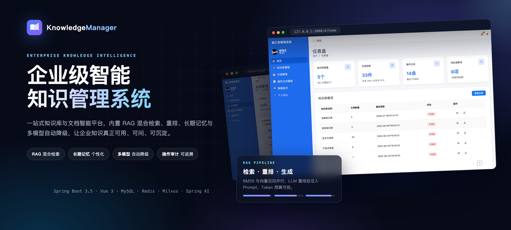
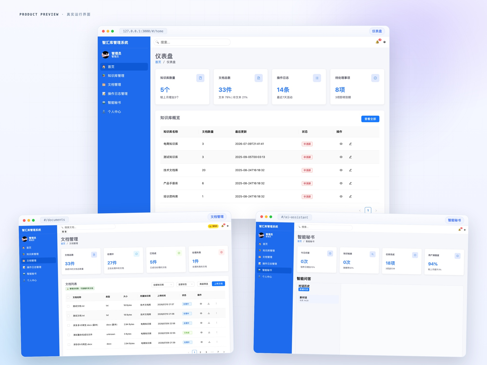
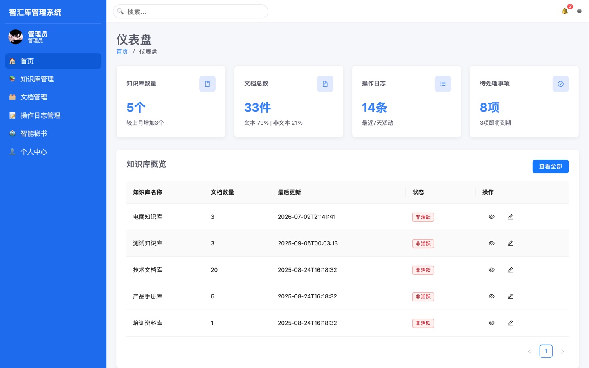
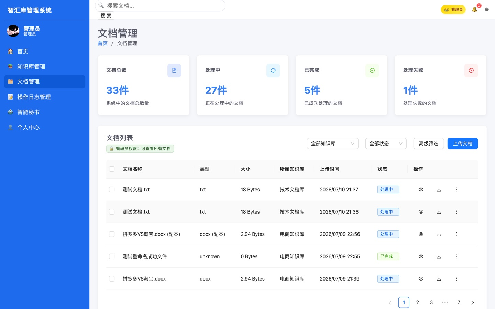
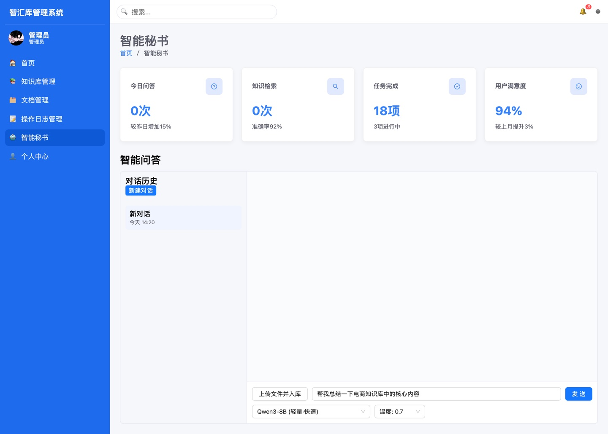
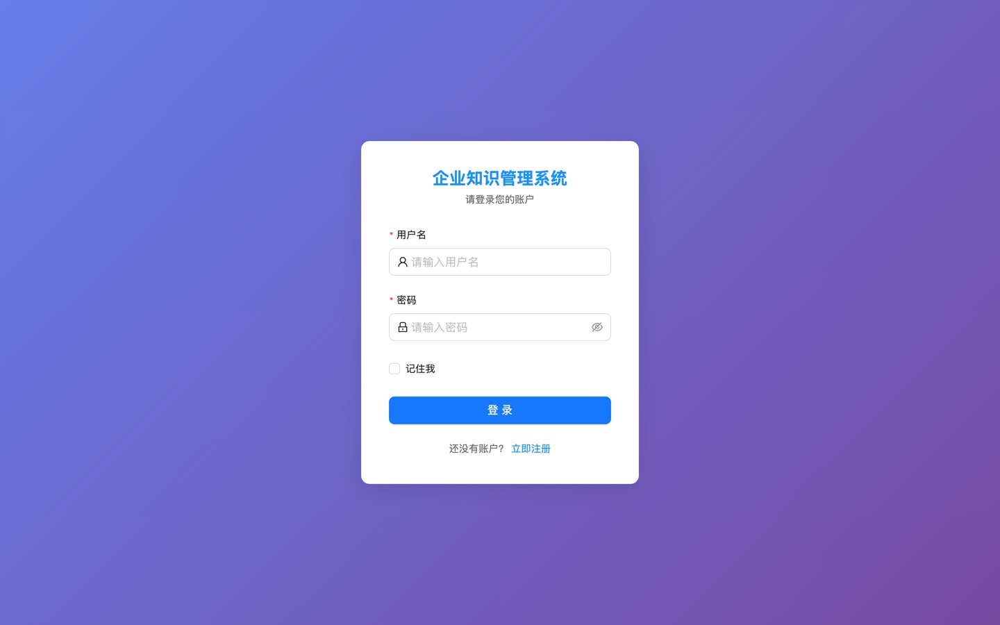
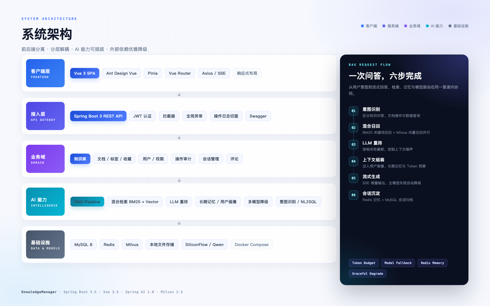

<p align="center">
  
</p>

<h1 align="center">KnowledgeManager</h1>

<p align="center"><strong>企业级智能知识管理系统</strong></p>

<p align="center">知识库管理 · 文档智能 · RAG 问答 · 长期记忆 · 操作审计</p>

<p align="center">
  
  
  
  
  
  
  <a href="LICENSE"></a>
</p>



> 把散落在文档、Wiki 和网盘里的企业知识，变成可检索、可问答、可沉淀的团队资产。

KnowledgeManager 是一个前后端分离的企业知识管理系统。后端基于 **Spring Boot 3 + MyBatis**，前端基于 **Vue 3 + Ant Design Vue**；在知识库、文档、权限与审计之上，叠加了 **RAG 检索增强、长期记忆、用户画像与多模型降级** 能力。

项目按可运行、可扩展的工程思路实现：JWT 认证、统一响应、全局异常、操作日志切面、分页、文件解析、SSE 流式输出、Prometheus 指标与 Docker Compose 一键启动。

## 界面预览

<a href="assets/showcase.jpg"></a>

<details>
<summary>查看单页截图</summary>

| 仪表盘 | 文档管理 |
| :---: | :---: |
|  |  |
| **智能秘书** | **登录** |
|  |  |

</details>

## 功能特性

| 模块 | 能力 |
| --- | --- |
| **知识库** | 新建 / 编辑 / 删除、部门归属、文档数量统计、批量删除、按知识库浏览 |
| **文档中心** | 上传解析（PDF / Word / TXT / Markdown）、关键词与多条件检索、预览、重命名、移动、复制、归档、软删除 / 物理删除、标签、收藏、评论 |
| **智能问答** | SSE 流式对话、会话历史、模型与温度选择、引用文档卡片、文件上传入库 |
| **RAG 管线** | 意图识别、BM25 + 向量混合召回、LLM 重排、Token 预算、Prompt 中间件管道 |
| **记忆体系** | Redis 短期窗口、长期记忆抽取 / 合并 / 召回、用户画像、超长对话摘要压缩 |
| **稳定性** | 多模型自动降级、LLM 指标、A/B 实验、缓存、Milvus 不可达时优雅降级 |
| **权限与审计** | JWT 认证、管理员 / 普通用户、操作日志切面、敏感操作标记、日志筛选与导出 |

## 系统架构

<a href="assets/architecture.png"></a>

- **客户端层**：Vue 3 SPA，Pinia 管理状态，Axios / SSE 与后端通信。
- **接入层**：Spring Boot REST API，JWT 拦截器统一鉴权，全局异常与操作日志切面。
- **业务域**：知识库、文档、标签、收藏、评论、用户与操作审计。
- **AI 能力**：RAG 管线、混合检索、LLM 重排、长期记忆、多模型降级、意图识别 / NL2SQL。
- **基础设施**：MySQL 持久化、Redis 会话与缓存、Milvus 向量库、本地文件存储、SiliconFlow（Qwen）。

<details>
<summary>RAG 请求链路</summary>

1. **意图识别**：区分知识问答、文档操作与数据查询。
2. **混合召回**：BM25 关键词召回与 Milvus 向量召回并行执行。
3. **LLM 重排**：按相关性截断，降低上下文噪声。
4. **上下文组装**：注入用户画像、长期记忆，并做 Token 预算控制。
5. **流式生成**：SSE 增量输出；主模型连续失败时自动切换降级模型。
6. **会话沉淀**：Redis 保存短期记忆，MySQL 归档会话与消息。

</details>

## 技术栈

| 分层 | 技术 |
| --- | --- |
| 后端 | Java 17、Spring Boot 3.5.4、MyBatis、PageHelper、Spring Security Crypto、JJWT |
| 前端 | Vue 3.5、Vite 4.5、Ant Design Vue 4.2、Pinia、Vue Router、Axios |
| AI | Spring AI 1.0、Spring AI Alibaba 1.0.0.2、SiliconFlow（Qwen）、Milvus、Redis |
| 存储 | MySQL 8、Redis、Milvus、本地文件系统 |
| 文档处理 | Apache Tika、PDFBox |
| 可观测性 | Spring Boot Actuator、Micrometer Prometheus、LLM 调用指标 |
| 部署 | Docker Compose、Maven Wrapper、npm |

## 快速开始

### 1. 环境要求

| 依赖 | 版本 |
| --- | --- |
| JDK | 17+ |
| Node.js | 20.19+ 或 22.12+ |
| MySQL | 8.0 |
| Redis | 7 |
| Docker | 可选，用于一键启动依赖 |
| Milvus | 2.5（可选，RAG / 向量检索需要） |

### 2. 克隆并启动依赖

```bash
git clone git@github.com:Yannnn22/knowledge-manager.git
cd knowledge-manager

# MySQL + Redis
docker compose up -d

# 如需 RAG / 向量检索，再启动 Milvus（etcd + MinIO + Milvus）
docker compose --profile ai up -d
```

> [!NOTE]
> MySQL 首次启动会自动执行 [`docs/schema.sql`](docs/schema.sql) 建表。如果本机已有 MySQL，也可以手动导入该文件，并跳过 Docker。

### 3. 启动后端

```bash
cd backend

export DB_PASSWORD=km123456
export SILICONFLOW_API_KEY=sk-你的Key
export JWT_SECRET=请替换为至少64位随机字符串

./mvnw spring-boot:run
```

后端默认地址为 `http://localhost:8080`，健康检查为 `/actuator/health`。

### 4. 启动前端

```bash
cd frontend
npm install
npm run dev
```

打开 `http://localhost:3000`，使用演示账号登录：

| 用户名 | 密码 | 角色 |
| --- | --- | --- |
| `admin` | `123456` | 管理员 |

> [!IMPORTANT]
> `admin / 123456` 由后端 `DataInitializer` 在首次启动时自动创建。部署到公网前，请立即修改密码并替换 `JWT_SECRET`。

> [!TIP]
> AI 问答需要配置 `SILICONFLOW_API_KEY`；向量检索与文件入库需要 Milvus。未启动 Milvus 时应用仍可启动，知识库 / 文档 / 审计等核心功能不受影响。

## 配置说明

后端所有敏感配置均通过环境变量注入，默认值仅用于本地开发。

| 环境变量 | 默认值 | 说明 |
| --- | --- | --- |
| `DB_URL` | `jdbc:mysql://127.0.0.1:3306/knowledge_manager...` | MySQL 连接串 |
| `DB_USERNAME` | `root` | 数据库用户名 |
| `DB_PASSWORD` | 空 | 数据库密码 |
| `REDIS_HOST` / `REDIS_PORT` | `localhost` / `6379` | Redis 连接 |
| `MILVUS_HOST` / `MILVUS_PORT` | `localhost` / `19530` | Milvus 连接 |
| `SILICONFLOW_API_KEY` | `not-configured` | 大模型与 Embedding 服务 Key |
| `JWT_SECRET` | 开发默认值 | 生产环境必须替换 |
| `FILE_UPLOAD_DIR` | `./uploads` | 上传文件存储目录 |
| `APP_AI_ENABLED` | `true` | 设为 `false` 可关闭 AI 相关接口 |

## 项目结构

```text
knowledge-manager/
├── backend/                  # Spring Boot 3 服务
│   ├── src/main/java/        # controller / service / mapper / advisor / retrieval
│   ├── src/main/resources/   # MyBatis XML、application.properties、Prompt 配置
│   └── pom.xml
├── frontend/                 # Vue 3 + Vite 前端
│   ├── src/pages/            # 登录、仪表盘、知识库、文档、日志、智能秘书
│   ├── src/api/              # 接口封装
│   └── vite.config.ts        # 开发代理配置
├── docs/                     # API、RAG、记忆体系、启动、变更、数据库 Schema
├── assets/                   # README 视觉素材与界面截图
├── docker-compose.yml        # MySQL / Redis / Milvus
└── README.md
```

## 文档

| 文档 | 内容 |
| --- | --- |
| [API 文档](docs/api.md) | 认证、知识库、文档、操作日志、AI 接口 |
| [API Reference](docs/api-reference.md) | 精简接口速查 |
| [RAG 架构设计](docs/rag-architecture.md) | 分块策略、混合检索、重排、Prompt、Token 预算 |
| [记忆体系设计](docs/memory-system.md) | 长短期记忆、用户画像、压缩与生命周期 |
| [企业级 Agent 架构](docs/enterprise-agent-architecture.md) | 多 Agent 编排与演进设计 |
| [启动指南](docs/startup.md) | 本地启动、依赖排查与常见问题 |
| [更新日志](docs/changelog.md) | 版本变更记录 |
| [数据库 Schema](docs/schema.sql) | 12 张表的完整建表语句 |

## 后续计划

- 细粒度 RBAC 与部门级数据权限。
- 文档版本管理、在线预览与对象存储（S3 / MinIO）。
- 检索评估集与 RAG 效果自动化回归。
- 前端组件拆分、单元测试与 Playwright E2E。

---

<p align="center">MIT License © 2026 Yannnn22</p>
