# 企业级多Agent智能助理架构设计文档

> 基于 KnowledgeManager 业务场景的企业级多Agent系统设计方案

---

## 目录

1. [业务场景分析](#1-业务场景分析)
2. [整体架构设计](#2-整体架构设计)
3. [多Agent编排模式](#3-多agent编排模式)
4. [技术栈选型与对比](#4-技术栈选型与对比)
5. [核心子系统设计](#5-核心子系统设计)
6. [工程实践要点](#6-工程实践要点)
7. [演进路线](#7-演进路线)

---

## 1. 业务场景分析

### 1.1 当前业务概述

KnowledgeManager 是一个面向企业的智能知识库管理系统，核心业务包括：

| 业务模块 | 核心功能 | 技术挑战 |
|---------|---------|---------|
| **文档管理** | 文件上传、分块、向量化、存储 | 大文件处理、分块策略、批处理 |
| **RAG问答** | 混合检索、重排、上下文注入 | 检索性能、检索精度、上下文管理 |
| **记忆系统** | 短期记忆、长期记忆、用户画像 | 记忆冲突、过期淘汰、上下文压缩 |
| **对话管理** | 多轮对话、流式响应、历史记录 | 状态管理、并发控制、数据一致性 |

### 1.2 企业级需求扩展

从单Agent到多Agent的业务演进：

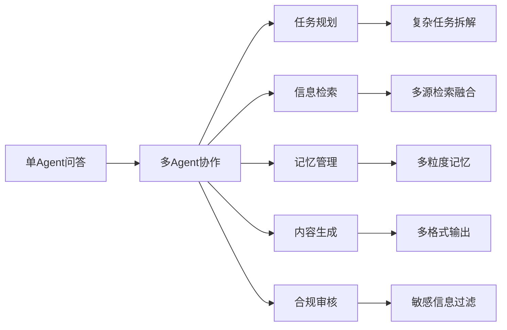

---

## 2. 整体架构设计

### 2.1 架构原则

| 原则 | 说明 |
|------|------|
| **模块化** | 每个Agent独立职责，通过标准化接口通信 |
| **可扩展** | 支持动态添加/替换Agent，不影响核心流程 |
| **可观测** | 完整的日志、指标、追踪体系 |
| **高可用** | 故障隔离、降级策略、熔断机制 |
| **安全合规** | 数据加密、权限控制、审计日志 |

### 2.2 整体架构图

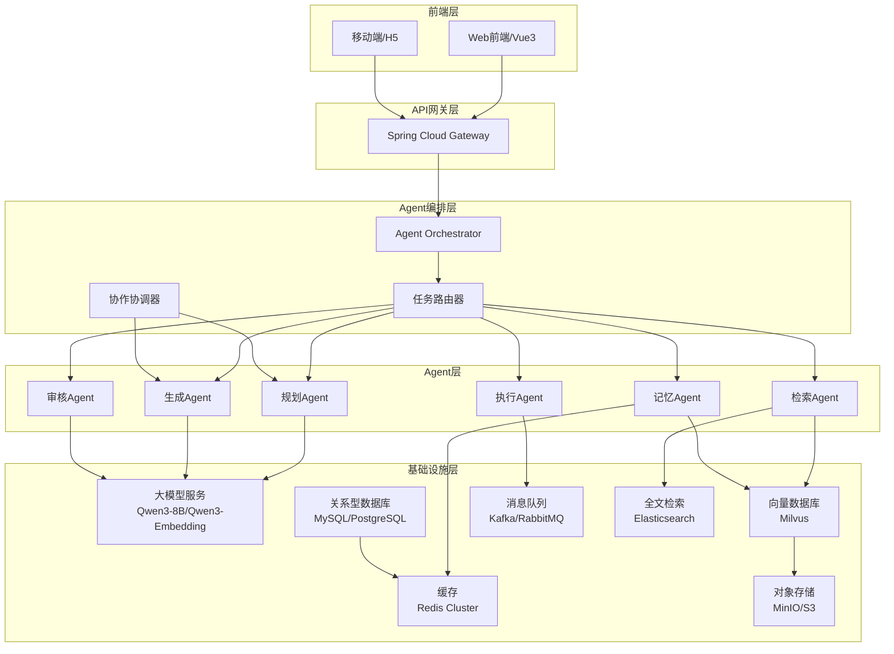

### 2.3 分层架构说明

| 层级 | 职责 | 关键组件 |
|------|------|---------|
| **前端层** | 用户交互、界面展示 | Vue3、WebSocket、流式渲染 |
| **API网关** | 请求路由、安全校验、限流 | Spring Cloud Gateway |
| **Agent编排层** | 任务分发、流程控制、状态管理 | LangGraph/自定义编排引擎 |
| **Agent层** | 专业能力单元 | 规划、检索、记忆、生成、审核、执行 |
| **基础设施层** | 数据存储、计算资源、消息传递 | Milvus、Redis、MySQL、Kafka、LLM |

---

## 3. 多Agent编排模式

### 3.1 Agent角色定义

| Agent | 职责 | 输入 | 输出 |
|-------|------|------|------|
| **规划Agent** | 任务拆解与规划 | 用户查询 | 子任务列表、执行计划 |
| **检索Agent** | 多源信息检索 | 查询、上下文 | 检索结果、文档片段 |
| **记忆Agent** | 记忆管理与检索 | 用户ID、查询 | 短期记忆、长期记忆、用户画像 |
| **生成Agent** | 内容生成与总结 | 上下文、检索结果 | 最终回答、结构化输出 |
| **审核Agent** | 合规检查与质量评估 | 生成内容 | 审核结果、修改建议 |
| **执行Agent** | 工具调用与动作执行 | 执行指令 | 执行结果、状态反馈 |

### 3.2 Agent协作序列图

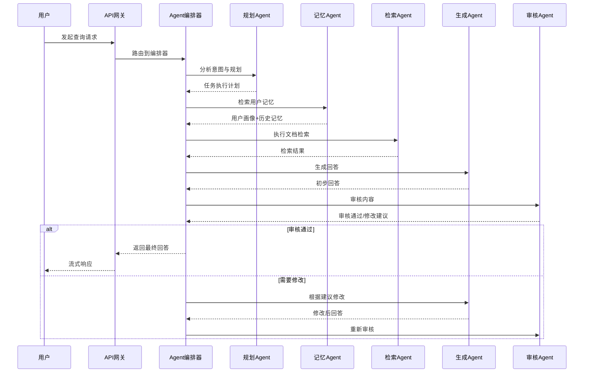

### 3.3 编排模式选择

| 模式 | 适用场景 | 优缺点 |
|------|---------|--------|
| **链式编排** | 简单任务、线性流程 | 简单直观，缺乏灵活性 |
| **路由编排** | 根据意图选择分支 | 灵活，需意图识别能力 |
| **图编排** | 复杂任务、多Agent协作 | 灵活可控，复杂度高 |
| **状态机编排** | 有状态的长对话 | 状态管理清晰，实现复杂 |

**推荐方案**：采用**图编排（LangGraph）**，支持循环、条件分支、状态持久化。

---

## 4. 技术栈选型与对比

### 4.1 Agent编排框架

| 方案 | 优点 | 缺点 | 选型建议 |
|------|------|------|---------|
| **LangGraph** | 状态机模式、支持多Agent、Python生态成熟 | Java支持有限、学习曲线陡 | 推荐（Python微服务） |
| **Spring AI Agent** | Spring生态、Java原生支持、与现有项目集成 | Agent模式较简单、社区小 | 备选（Java单体） |
| **AutoGen** | 微软出品、多Agent协作成熟、支持代码执行 | 依赖微软生态、Java支持差 | 备选（研究用途） |
| **自定义编排引擎** | 完全可控、贴合业务 | 开发成本高、维护负担重 | 不推荐 |

**选型决策**：采用**LangGraph**作为Agent编排引擎，部署为独立微服务，通过API与Spring Boot主应用通信。

### 4.2 向量数据库

| 方案 | 优点 | 缺点 | 选型建议 |
|------|------|------|---------|
| **Milvus** | 高性能、高可用、支持GPU加速 | 部署复杂、资源消耗大 | 推荐 |
| **Qdrant** | 轻量、易于部署、RESTful API | 集群能力较弱 | 备选（小型场景） |
| **Pinecone** | 托管服务、无需运维、全球部署 | 成本高、数据主权问题 | 备选（云原生） |
| **Weaviate** | GraphQL接口、语义搜索、模块化设计 | 社区较小、性能一般 | 备选 |

**选型决策**：当前项目已使用**Milvus**，保持不变。企业级部署采用Milvus Cluster模式。

### 4.3 缓存层

| 方案 | 优点 | 缺点 | 选型建议 |
|------|------|------|---------|
| **Redis Cluster** | 高性能、高可用、支持多种数据结构 | 运维复杂、内存成本高 | 推荐 |
| **Redis Sentinel** | 主从复制、自动故障转移 | 扩展性有限 | 备选（中小型） |
| **Caffeine** | 本地缓存、零延迟、LRU策略 | 不支持分布式、容量有限 | 配合使用 |

**选型决策**：采用**Redis Cluster** + **Caffeine**二级缓存架构。

### 4.4 消息队列

| 方案 | 优点 | 缺点 | 选型建议 |
|------|------|------|---------|
| **Kafka** | 高吞吐、持久化、流式处理 | 部署复杂、运维成本高 | 推荐（大规模） |
| **RabbitMQ** | 轻量、协议丰富、易于使用 | 吞吐较低 | 备选（中小型） |
| **RocketMQ** | 阿里出品、高可用、事务消息 | Java生态、社区较小 | 备选（阿里技术栈） |

**选型决策**：采用**Kafka**处理异步任务（文档处理、记忆提取、摘要生成）。

### 4.5 技术栈全景图

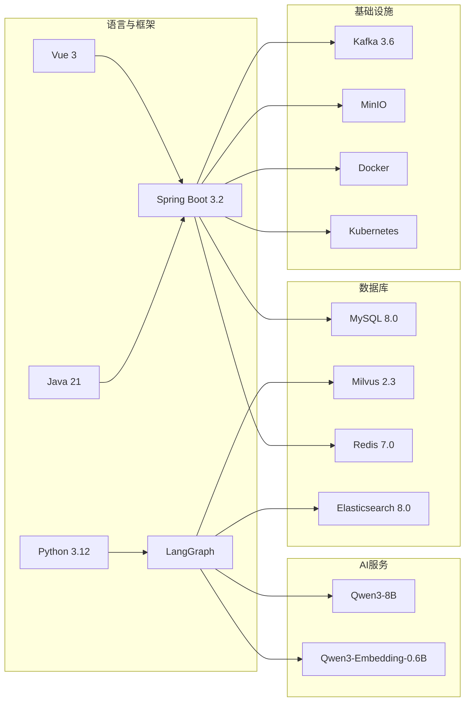

---

## 5. 核心子系统设计

### 5.1 记忆系统设计

#### 5.1.1 记忆分层架构

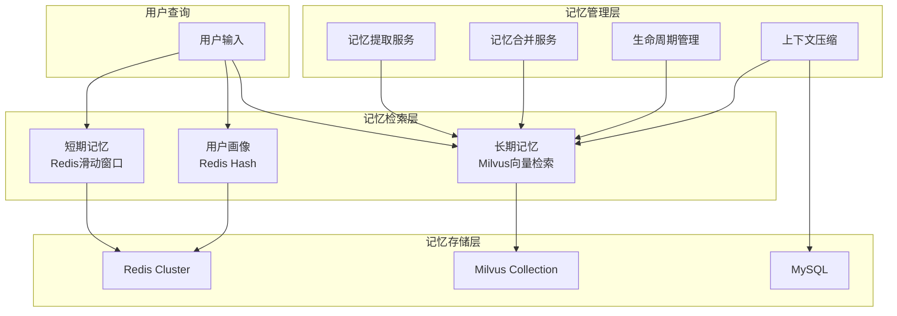

#### 5.1.2 记忆检索流程

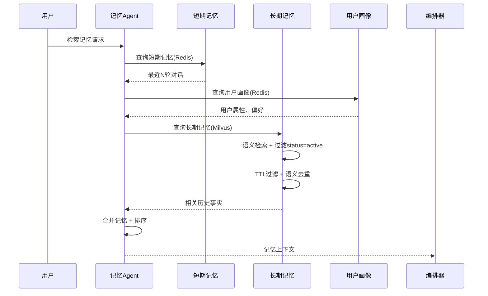

#### 5.1.3 记忆冲突处理（双时间线）

| 状态 | 含义 | 检索行为 | 存储行为 |
|------|------|---------|---------|
| **active** | 当前有效 | 正常检索 | 新记忆默认 |
| **expired** | 已被取代 | 正常检索排除 | 冲突时旧记忆变更 |

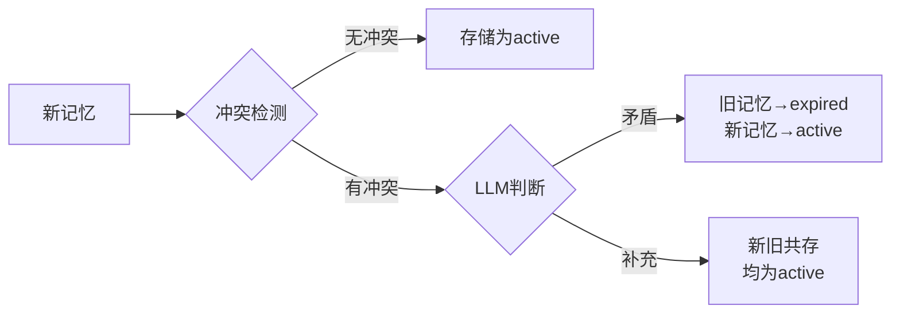

### 5.2 RAG检索系统设计

#### 5.2.1 混合检索流程

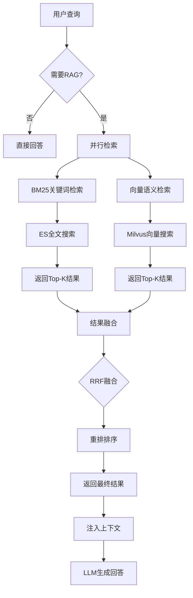

#### 5.2.2 检索优化策略

| 优化项 | 当前实现 | 企业级改进 |
|--------|---------|-----------|
| **并行检索** | CompletableFuture并行 | 使用线程池隔离、超时控制 |
| **结果融合** | RRF算法 | BM25权重可调、自适应融合 |
| **语义去重** | Jaccard相似度 | Embedding余弦相似度去重 |
| **重排策略** | 已移除LLM重排 | 可选Cross-Encoder轻量重排 |

### 5.3 文档处理系统设计

#### 5.3.1 文件上传与处理流程

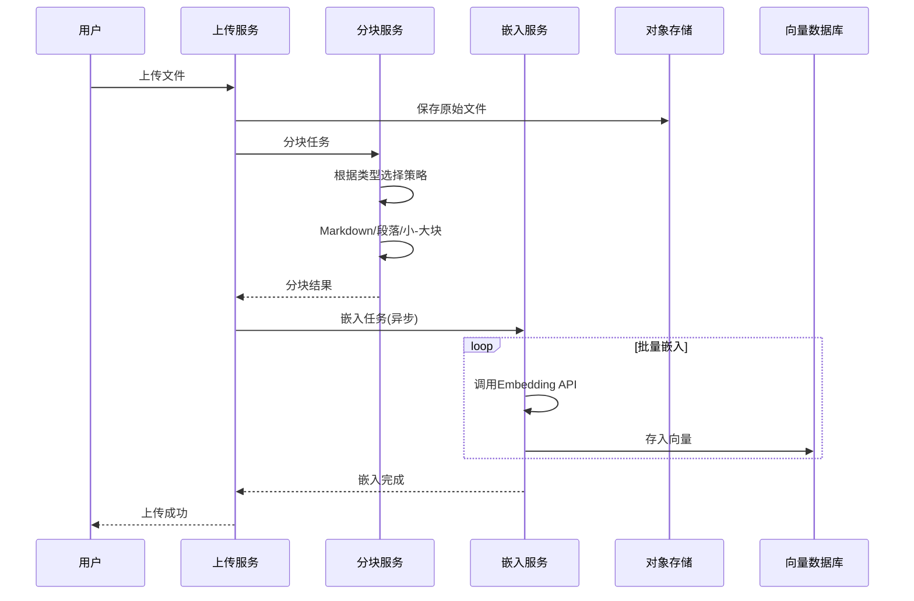

#### 5.3.2 分块策略矩阵

| 文件类型 | 策略 | chunk_size | overlap | 特殊处理 |
|---------|------|-----------|---------|---------|
| **Markdown** | MarkdownChunkStrategy | 500-1000 | 100-200 | 按标题递归分块 |
| **代码** | SmallLargeChunkStrategy | 300/1500 | 50/300 | 小块保持完整函数 |
| **PDF/文档** | ParagraphChunkStrategy | 800 | 150 | 按段落分块 |
| **通用文本** | SmallLargeChunkStrategy | 400/1200 | 80/200 | 小-大块组合 |

---

## 6. 工程实践要点

### 6.1 高可用设计

| 组件 | 策略 | 实现方式 |
|------|------|---------|
| **LLM调用** | 超时重试、熔断降级 | Resilience4j、Hystrix |
| **向量检索** | 超时控制、优雅降级 | CompletableFuture.get(timeout) |
| **缓存** | 多级缓存、击穿防护 | Redis + Caffeine |
| **数据库** | 读写分离、连接池 | MySQL主从、HikariCP |
| **服务** | 健康检查、自动重启 | Spring Actuator、K8s探针 |

### 6.2 可观测性

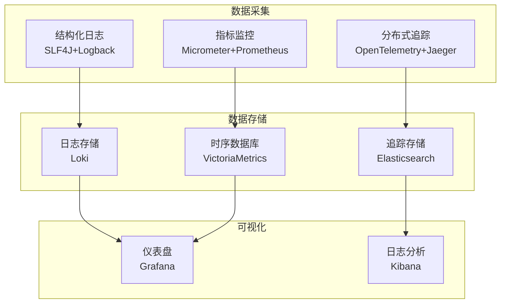

**关键指标**：
- 检索耗时（BM25/向量/融合）
- LLM调用耗时与成功率
- 记忆命中率
- 缓存命中率
- Token消耗统计

### 6.3 安全性

| 安全维度 | 措施 | 实现方式 |
|---------|------|---------|
| **认证授权** | JWT、RBAC | Spring Security + JWT |
| **数据加密** | 传输加密、存储加密 | HTTPS、AES-256 |
| **输入校验** | 参数校验、敏感词过滤 | Bean Validation、敏感词库 |
| **输出审核** | 内容审核、合规检查 | 审核Agent、规则引擎 |
| **审计日志** | 操作记录、行为追踪 | AOP切面、MySQL存储 |

### 6.4 性能优化

| 优化方向 | 策略 | 预期收益 |
|---------|------|---------|
| **检索优化** | 并行检索、索引优化 | 检索耗时降低50%+ |
| **缓存优化** | 多级缓存、预热策略 | 响应延迟降低80%+ |
| **异步处理** | 消息队列、批量处理 | 吞吐量提升300%+ |
| **资源控制** | 线程池隔离、限流 | 系统稳定性提升 |
| **模型优化** | 模型量化、推理优化 | 推理速度提升200%+ |

### 6.5 常见问题与解决方案

| 问题 | 根因 | 解决方案 | 验证方式 |
|------|------|---------|---------|
| **向量检索超时** | BM25和向量检索串行执行 | 并行执行 + 超时控制 | 检索耗时从60s降到500ms |
| **记忆丢失** | ThreadLocal异步线程切换 | 改用参数传递 | userId正确传递 |
| **上下文过长** | 消息条数无限制累积 | 滑动窗口 + 摘要压缩 | Token使用可控 |
| **记忆冲突** | 新事实覆盖旧事实 | 双时间线机制 | 旧事实可追溯 |
| **检索重复** | 无去重机制 | 语义去重（相似度>0.85） | 结果多样性提升 |

---

## 7. 演进路线

### 7.1 阶段规划

| 阶段 | 时间 | 目标 | 关键任务 |
|------|------|------|---------|
| **Phase 1** | 0-3个月 | 单Agent稳定运行 | 基础功能完善、性能优化、可观测性建设 |
| **Phase 2** | 3-6个月 | 多Agent架构落地 | Agent编排引擎、多Agent协作模式、异步任务队列 |
| **Phase 3** | 6-9个月 | 企业级能力建设 | 高可用架构、安全合规、精细化运营 |
| **Phase 4** | 9-12个月 | 智能化演进 | 自适应检索、记忆质量反馈、模型微调 |

### 7.2 架构演进图

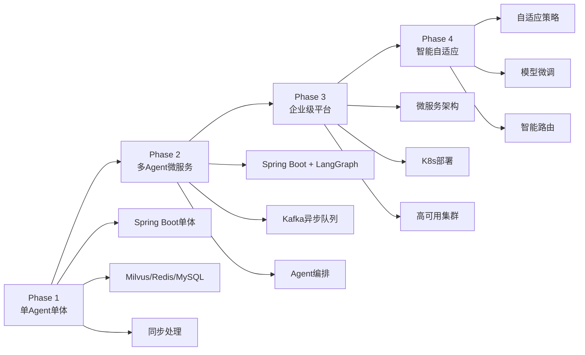

### 7.3 里程碑

| 里程碑 | 交付物 | 验收标准 |
|--------|--------|---------|
| **M1** | RAG检索性能达标 | 检索耗时<1s，准确率>85% |
| **M2** | 记忆系统完善 | 短期记忆命中率>90%，长期记忆可追溯 |
| **M3** | 多Agent协作 | 支持规划、检索、生成、审核协作 |
| **M4** | 企业级上线 | 高可用(99.9%)、安全合规、完整可观测 |
| **M5** | 智能化运营 | 自适应策略、质量反馈闭环、成本优化 |

---

## 附录：当前项目代码结构参考

```
KnowledgeManager/
├── src/main/java/zjc/knowledgemanager/
│   ├── advisor/           # Agent中间件链
│   │   ├── LongTermMemoryRetrievalAdvisor.java
│   │   ├── UserProfileAdvisor.java
│   │   ├── ConversationCompressionAdvisor.java
│   │   └── TokenBudgetAdvisor.java
│   ├── middleware/        # 编排管道
│   │   ├── PromptPipeline.java
│   │   └── MiddlewareContext.java
│   ├── service/           # 核心服务
│   │   ├── retrieval/     # 检索服务
│   │   │   ├── HybridRetriever.java
│   │   │   └── BM25Retriever.java
│   │   ├── chunk/         # 分块服务
│   │   │   ├── ChunkStrategyFactory.java
│   │   │   └── SmallLargeChunkStrategy.java
│   │   └── Memory*.java   # 记忆相关服务
│   ├── config/ai/         # AI配置
│   │   ├── MilvusConfig.java
│   │   ├── LongTermMemoryConfig.java
│   │   └── MemoryProperties.java
│   └── controller/ai/     # AI控制器
│       ├── RagController.java
│       └── ConversationController.java
└── src/main/resources/
    └── application.properties
```

---

**文档版本**: v1.0  
**创建日期**: 2026-07-08  
**适用场景**: KnowledgeManager企业级多Agent架构设计参考

---

*本文档基于当前项目实际业务场景，结合企业级架构最佳实践编写，可作为后续系统演进的参考蓝图。*